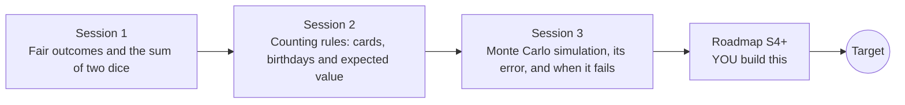

# openodds

[](https://github.com/KrunalPanchal1995/openodds/actions/workflows/ci.yml)   [](https://colab.research.google.com/github/KrunalPanchal1995/openodds/blob/main/sessions/session-01/lesson.ipynb) [](https://krunalpanchal1995.github.io/openodds/)

**Count the odds, then check them by simulation, in three sessions.**

openodds teaches how to find the chance of an event in dice, cards and lotteries, first by counting and then by seeded computer simulation, using only Python and a browser.

- **Start from zero.** Session 1 needs only fractions and counting; every symbol is explained.
- **See it settle.** Every session ships a slider app that runs in the browser, with labelled graphs.
- **Know you got it right.** Each session ends with a checkpoint that prints PASS or FAIL against exact counts and hand calculations.
- **Build the missing half.** The repo stops at Session 3 on purpose; the roadmap shows the path to the Target.

[Target](#the-target) · [Who is this for](#who-is-this-for) · [Quick start](#quick-start) · [Sessions](#sessions) · [Roadmap](#roadmap) · [Contribute](#contribute) · [Explainer PDF](docs/explainer.pdf)

> **This repo is incomplete on purpose.** Sessions 1 to 3 are here and fully working. The finished Target below is a preview of what the community can build next. We show you the path, not the code. Sessions 4 and up are yours.

## The Target

Two panels fill up as the number of simulated trials grows from 20 to 40,000. On the left, bars for every sum of two dice settle onto the exact counts, each with a 95 percent error bar that shrinks like one over the square root of N. On the right, the birthday curve is estimated from simulated rooms and hugs the exact curve inside its error band, reaching 0.507 at 23 people. Your goal over the coming sessions: build that experiment yourself, with an honest error estimate, and then extend it to events that plain simulation cannot reach.


*Target: simulated frequencies converge onto exact probabilities, with error bands*


*Target at 40,000 trials: dice sums and the birthday curve*

Try it live:

- [Math Visual Studio: probability (Atlas S24)](https://krunalpanchal1995.github.io/studio/#atlas?ch=S24&ex=1)

How the Target was made is shown only as a path in [promo/roadmap.md](promo/roadmap.md).

## Who is this for
**secondary school to diploma / undergraduate (levels 3-5).** Topic area: Mathematics and Visual Problem-Solving.

Prerequisites:

- Fractions, percentages and basic multiplication (school mathematics).
- Python 3.10 or newer; if `python --version` works, you are ready. PRIMER.md explains the rest.
- No prior GitHub, statistics or programming-in-probability experience is needed.

New to Python? Read [PRIMER.md](PRIMER.md) first (10 minutes).

## Quick start

No installation knowledge needed. You need [Git](https://git-scm.com/downloads) and [Python 3.10+](https://www.python.org/downloads/) (Windows: tick "Add Python to PATH"). On Mac and Linux type `python3` wherever this page says `python`.

```bash
git clone https://github.com/KrunalPanchal1995/openodds.git
cd openodds
python start.py 1
```

`start.py` creates a private environment, installs what is needed and runs Session 1 with its checkpoint. Next: `python start.py 2`, `python start.py 3`, or `python start.py test` to check everything. Only a checkpoint: `python start.py check 1`.

Four lines turn the idea of Session 1 into a result (they work as they are): Save it as `try.py` and run it with `python start.py run try.py` (this uses the private environment, where NumPy is installed):

```python
import numpy as np
rng = np.random.default_rng(1)                       # seeded: same rolls every run
sums = rng.integers(1, 7, 100000) + rng.integers(1, 7, 100000)
print(round(float((sums == 7).mean()), 3), 'versus exact', round(6 / 36, 3))   # -> 0.164 versus exact 0.167
```

Every session also opens in your browser with sliders (no install): [live apps](https://krunalpanchal1995.github.io/openodds/). Or use the Colab badge above for the notebook.

## Sessions

| # | Session | Model level | Time | Live app |
|---|---|---|---|---|
| 1 | [Fair outcomes and the sum of two dice](sessions/session-01/README.md) | Level 1: conceptual interactive model | 60 min | [open](https://krunalpanchal1995.github.io/openodds/session-01/) |
| 2 | [Counting rules: cards, birthdays and expected value](sessions/session-02/README.md) | Level 2: mathematical engineering model | 75 min | [open](https://krunalpanchal1995.github.io/openodds/session-02/) |
| 3 | [Monte Carlo simulation, its error, and when it fails](sessions/session-03/README.md) | Level 3: simulation and validation | 90 min | [open](https://krunalpanchal1995.github.io/openodds/session-03/) |

Each session follows the same six steps: A real-world problem, B concept and theory, C visual explanation, D interactive simulation, E worked example and experiment, F assessment and design challenge. Each ends with `checkpoint.py`, which prints `PASS` or `FAIL` against reference numbers. Session 3 also contains the real-world mini-project: **Design a fair game and check it by simulation**.

## Architecture



| Folder or file | What is inside |
|---|---|
| `sessions/` | three sessions: README (A-F), `lesson.py`, notebook, live app, exercises, activity sheet, checkpoint |
| `promo/` | the Target: media, live links, and the roadmap (path only) |
| `docs/` | `explainer.tex` and the built `explainer.pdf` |
| `tests/` | runs every lesson and checkpoint headless |
| `start.py` | one command to set up and run anything |
| `QUALITY.md`, `RUBRIC.md` | the quality checklist and the scoring rubric |
| `.github/` | CI, PDF build, Pages deploy, issue and PR templates |

## Roadmap

| Milestone | What you will build | Difficulty |
|---|---|---|
| Session 4: Importance sampling for a rare event | An estimator of the probability that 8 dice all show 6 (exactly 6^-8) that samples biased dice and weights each sample. | advanced |
| Session 5: The full poker table | A function returning the count of every hand type for 5-card poker, checked against simulation. | intermediate |
| Session 6: Lottery prize tiers and honest expected value | A table of the number of draws for each match count and the expected return for an illustrative prize list. | intermediate |
| Session 7: Conditional probability: Monty Hall | A seeded simulation of the game with a confidence statement from the standard error. | intermediate |
| Session 8: Animate convergence like the Target | An animation of simulated dice-sum frequencies and a birthday curve converging with 95 percent bands. | advanced |

Full detail with a checkpoint per milestone: [promo/roadmap.md](promo/roadmap.md).

## Contribute
New to GitHub? Read [CONTRIBUTING.md](CONTRIBUTING.md); it starts from zero. Pick an issue labelled `good first issue`. Translations into Hindi, Telugu, Tamil and Malayalam are welcome.

<details>
<summary>Development</summary>

```bash
python start.py test        # runs every lesson and checkpoint
```
Lessons use `# %%` cell markers so they open as notebooks in VS Code. See [QUALITY.md](QUALITY.md) for the standard every session meets.
</details>

## License
MIT. See [LICENSE](LICENSE). Media in `promo/media` is (c) Krunal Panchal, CC BY 4.0.

## Acknowledgments
Part of the [PAN IIT OSS](https://hellofoss.tech-iitb.org/projects) open-source teaching collection, modelled on the structure of [openspline](https://github.com/openspline/openspline). Built on ideas from the Math Visual Studio at https://krunalpanchal1995.github.io/studio/.
