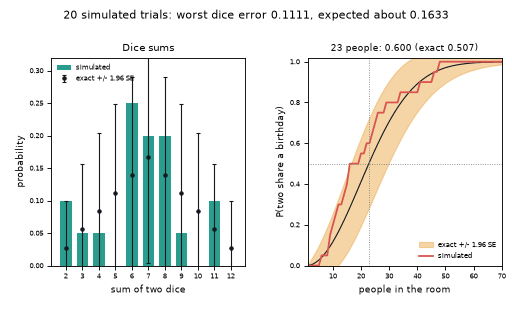
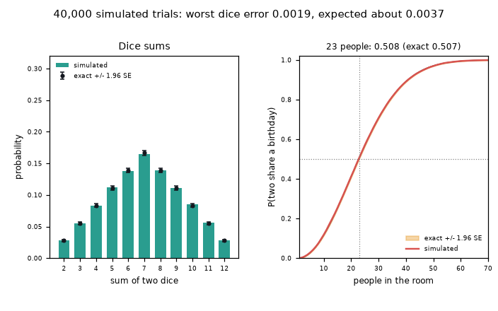

# What you are building toward

Two panels fill up as the number of simulated trials grows from 20 to 40,000. On the left, bars for every sum of two dice settle onto the exact counts, each with a 95 percent error bar that shrinks like one over the square root of N. On the right, the birthday curve is estimated from simulated rooms and hugs the exact curve inside its error band, reaching 0.507 at 23 people. Your goal over the coming sessions: build that experiment yourself, with an honest error estimate, and then extend it to events that plain simulation cannot reach.

*Target: simulated frequencies converge onto exact probabilities, with error bands*

*Target at 40,000 trials: dice sums and the birthday curve*

These results come from a private reference build. The code is not published; the roadmap shows the path so you can build your own.

Live links:

- [Math Visual Studio: probability (Atlas S24)](https://krunalpanchal1995.github.io/studio/#atlas?ch=S24&ex=1)
