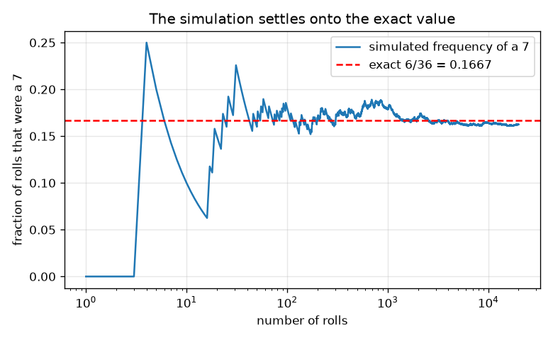
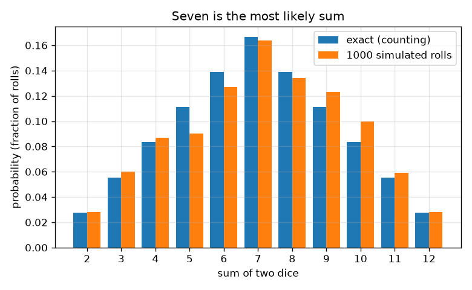

# Session 1: Fair outcomes and the sum of two dice

*Level 1 (conceptual interactive model) · about 60 minutes · openodds*

> This is a simplified educational model. It is not a validated design tool and must not be used for real structures, electrical installations, vehicles, industrial processes or medical decisions.

**Prerequisites**

- Fractions and multiplication.
- You have read PRIMER.md and run `python start.py 1` once.

**Learning objectives.** After this session you can:

- List the sample space of one and two fair dice and say why every outcome is equally likely.
- Compute a probability as favourable outcomes divided by total outcomes.
- Explain why 7 is the most likely sum of two dice, using the bar chart.
- Run a seeded simulation and see its frequencies settle onto the exact values.

## A. Real-world problem
In a board game you roll two dice and add them. Players say that 7 'comes up a lot' and 2 or 12 are rare. Is that real, or just memory? We can settle it by listing everything that can happen, counting, and then checking the count against thousands of virtual rolls. This is education about chance only, not betting advice.

## B. Concept and theory
The sample space is the list of all possible outcomes. For a fair die each of the 6 faces is equally likely, so each has probability 1/6. For two dice an outcome is a pair (first, second), so there are 6 x 6 = 36 equally likely outcomes; (1, 2) and (2, 1) are different outcomes. When outcomes are equally likely, the probability of an event is the number of favourable outcomes divided by the total number of outcomes. A sum of 7 can be made six ways, (1,6), (2,5), (3,4), (4,3), (5,2), (6,1), while a sum of 2 can be made only one way, (1,1). The relative frequency of an event in n simulated trials is the number of times it happened divided by n; the law of large numbers says it settles near the true probability as n grows.

| Symbol | Meaning | Unit |
|---|---|---|
| s | sum of the two dice | no unit (2 to 12) |
| c(s) | number of outcomes with sum s | count |
| P(s) | probability of sum s | no unit (0 to 1) |
| n | number of simulated rolls | count |
| f(s) | relative frequency of sum s in the simulation | no unit (0 to 1) |

**Assumptions**

- The dice are fair: each face has probability 1/6.
- The two dice do not influence each other.
- Simulated rolls come from a seeded pseudo-random generator, which behaves like fair dice for this purpose.

$$ P(\text{event})=\dfrac{\text{favourable outcomes}}{\text{total outcomes}} $$

$$ P(s)=\dfrac{c(s)}{36},\qquad c(s)=6-|s-7|\quad (s=2,\dots,12) $$

$$ \sum_{s=2}^{12}P(s)=1 $$

$$ f(s)=\dfrac{\text{rolls with sum } s}{n}\;\longrightarrow\;P(s)\quad (n\to\infty) $$

## C. Visual explanation
The first figure is a bar chart of the exact probability of each sum next to the frequencies from 1000 simulated rolls: the bars form a tent with its peak at 7 (6/36 = 0.167) and its feet at 2 and 12 (1/36 = 0.028). The second figure follows the frequency of a 7 as the number of rolls grows on a logarithmic axis. It wobbles wildly for a few rolls, then settles close to the red dashed line at 6/36.

*The frequency of a 7 wobbles at first and settles onto the exact value 6/36.*

*Exact probabilities of each sum of two dice next to 1000 simulated rolls: seven is the most likely.*

## D. Interactive simulation
Run the lesson (`python start.py 1`), then open the live app: [Session 1: two dice](https://krunalpanchal1995.github.io/openodds/session-01/) (or `app.html` in this folder). Pick a sum and a number of rolls. In the grid view see which of the 36 cells make that sum; in the bar view compare the exact bar with the simulated bar and watch the gap shrink as you add rolls.

**Challenge.** Choose the most likely sum and run at least 1000 rolls.

## E. Worked example and experiment
**Problem.** What is the probability that two fair dice add up to 7? Check it by counting all outcomes.

1. List the outcomes: 6 x 6 = 36 equally likely pairs.
2. Favourable pairs: (1,6), (2,5), (3,4), (4,3), (5,2), (6,1). That is 6 pairs.
3. P(7) = 6 / 36 = 1/6 = 0.1667.
4. Sanity check: the 11 possible sums have 1,2,3,4,5,6,5,4,3,2,1 outcomes, which add up to 36, so the probabilities add up to 1.

**Answer.** P(7) = 6/36 = 1/6, about 0.167: the most likely sum.

**Experiment.** Roll two real dice 100 times and tally the sums, then compare with the exact table and with the simulation. With 100 rolls the frequency of 7 will typically be between about 0.10 and 0.24, so you may not even see 7 on top. The model is exact; a real small sample is noisy, and real dice are never perfectly fair.

## F. Assessment and design challenge
**Question type A: Conceptual.** A friend says: 'Sums 6 and 8 each appear less often than 7, but 6 and 8 together appear more often than 7 and 12 together.' Is that right? Why is (1, 2) not the same outcome as (2, 1)?

Hint

Count the outcomes of each sum and add.

Step-by-step solution

Sums 6 and 8 have 5 + 5 = 10 outcomes; 7 and 12 together have 6 + 1 = 7 outcomes, so yes. (1, 2) and (2, 1) are different outcomes (first die 1 and second die 2, or the other way round); listing both is what makes all 36 outcomes equally likely and gives the sum 3 two ways, which is why 3 is twice as likely as 2.

**Question type B: Numerical.** Find the probability that the sum of two dice is at least 10. Give your answer as a fraction and a decimal and check that it is between 0 and 1.

Hint

Count the outcomes for sums 10, 11 and 12 using c(s) = 6 - |s - 7|.

Step-by-step solution

c(10) = 3, c(11) = 2, c(12) = 1, so 6 favourable outcomes. P = 6/36 = 1/6 = 0.167. It is between 0 and 1, and it is the same as P(7), which makes sense because the counts 3 + 2 + 1 equal 6.

**Question type C: Graph and simulation interpretation.** In the convergence figure, the frequency of a 7 after 10 rolls is far from 0.167 but after 20000 rolls it is very close. Does this mean the next roll is 'due' to be a 7 if the early frequency was too low?

Hint

Think about what settles: the fraction or the counts?

Step-by-step solution

No. Each roll is independent and still has probability 1/6 of being a 7. The fraction settles because the early surplus or shortage is spread over more and more rolls, not because later rolls compensate. The size of the wobble falls roughly like one over the square root of n; Session 3 makes this exact.

**Question type D: Design and optimisation challenge.** Design a game: you win if the sum is in a set S that you choose. Choose S so that the probability of winning is exactly 1/3, using as few different sums as you can, and say what trade-off you made.

Hint

You need 12 favourable outcomes out of 36.

Step-by-step solution

You need 12 favourable outcomes out of 36. One choice is the sums 4, 7 and 10: 3 + 6 + 3 = 12, so S = {4, 7, 10} wins with probability 12/36 = 1/3. A single sum cannot do it because the largest count is 6, and two sums give at most 6 + 5 = 11. Trade-off: fewer sums means simpler rules but smaller reachable probabilities. Assumption: fair dice.

Score yourself with [RUBRIC.md](../../RUBRIC.md). Print the [activity sheet](activity_sheet.md) to work on paper.

## Common misconceptions
| Common misconception | What is actually true |
|---|---|
| All sums of two dice are equally likely because there are 11 of them. | The 11 sums are not equally likely. The 36 pairs are. Sum 7 owns 6 pairs and sum 2 owns 1. |
| (1, 2) and (2, 1) are the same outcome. | With two distinct dice they are different outcomes, and counting both is what keeps all 36 outcomes equally likely. |
| After a long run without a 7, a 7 is more likely. | Dice have no memory. Every roll has the same probability; the fraction settles, the counts need not even out. |

## Glossary
- **sample space**: the list of all possible outcomes
- **event**: a set of outcomes we care about, such as 'the sum is 7'
- **probability**: a number from 0 (impossible) to 1 (certain); favourable divided by total for equally likely outcomes
- **relative frequency**: how often an event happened divided by the number of trials
- **seed**: a starting number that makes a pseudo-random generator repeat exactly

## Finish
1. Do the three coding tasks in [exercises.md](exercises.md).
2. Run `python start.py 1` again after your changes. It ends with the checkpoint; when it prints `PASS`, you are done. (Checkpoint only: `python start.py check 1`.)

Next: [Session 2](../session-02/README.md)
