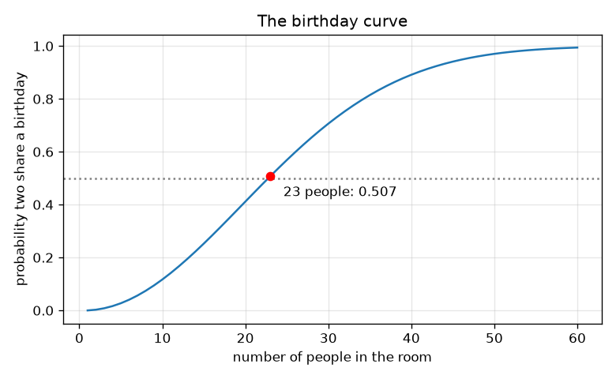
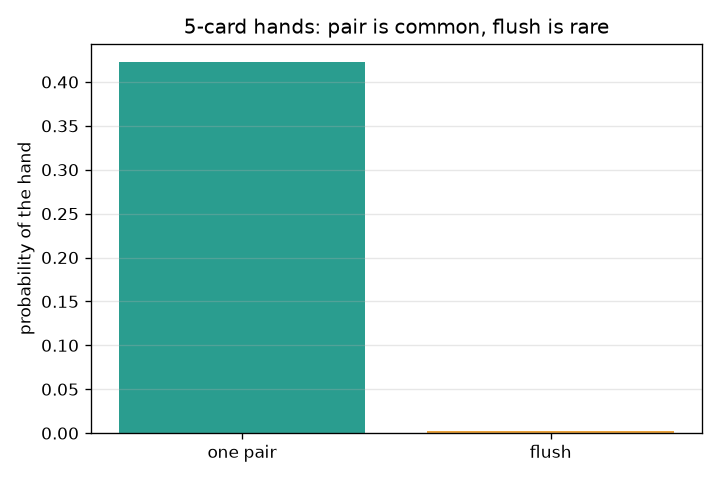

# Session 2: Counting rules: cards, birthdays and expected value

*Level 2 (mathematical engineering model) · about 75 minutes · openodds*

> This is a simplified educational model. It is not a validated design tool and must not be used for real structures, electrical installations, vehicles, industrial processes or medical decisions.

**Prerequisites**

- Session 1: sample space and favourable over total.
- Multiplication and factorials are explained in Section B.

**Learning objectives.** After this session you can:

- Use the multiplication rule for independent events and count with permutations and combinations (n choose k).
- Compute exact probabilities of a pair and of a flush in a 5-card poker hand with math.comb.
- Compute the birthday probability by the 'all different' product and explain why 23 people are enough for about 0.507.
- Compute an expected value and set a prize so that a raffle game breaks even.

## A. Real-world problem
Counting 36 outcomes is easy; counting 2.6 million poker hands is not. Do 23 people in a room really have a better than even chance of sharing a birthday? Could a school fair raffle ticket be priced so that the fair neither gains nor loses on average? All three questions are answered by the same idea: count cleverly, then divide. The raffle and prizes are made-up examples; this is education about chance, not betting advice.

## B. Concept and theory
Equally likely outcomes: P = favourable / total. If two events are independent, P(both) = P(first) x P(second); for example two sixes in a row has probability 1/6 x 1/6 = 1/36. A permutation is an ordered selection: there are n!/(n-k)! ways to pick and line up k of n objects. A combination ignores order: C(n, k) = n!/(k!(n-k)!), 'n choose k'. A 5-card hand is a combination, so there are C(52, 5) = 2,598,960 equally likely hands. Exactly one pair: choose the rank (13), its two suits C(4,2) = 6, three other different ranks C(12,3) = 220, and a suit for each, 4^3 = 64, giving 13 x 6 x 220 x 64 = 1,098,240 hands. A flush (five cards of one suit, straight flushes included): 4 x C(13,5) = 4 x 1287 = 5,148 hands. Birthday problem: P(all n birthdays differ) = (365/365)(364/365)...((365-n+1)/365), so P(shared) = 1 minus that. The expected value of a quantity that takes value v_i with probability p_i is the sum of v_i p_i, the long-run average. A game is fair when the expected net gain is 0.

| Symbol | Meaning | Unit |
|---|---|---|
| n, k | number of objects, number chosen | count |
| C(n, k) | number of unordered selections | count |
| P | probability | no unit (0 to 1) |
| N_t | number of raffle tickets sold | tickets |
| c | ticket price | Rs |
| R | prize for the single winning ticket | Rs |
| E | expected net gain per ticket | Rs |

**Assumptions**

- Cards are dealt from a well-shuffled 52-card deck, so every hand is equally likely.
- Birthdays: 365 equally likely days, leap years ignored, people independent.
- Raffle: exactly one prize, each ticket equally likely to win. Prices and prizes are illustrative.

$$ P(A\text{ and }B)=P(A)\,P(B)\quad(\text{independent events}) $$

$$ {}^{n}P_{k}=\dfrac{n!}{(n-k)!},\qquad \binom{n}{k}=\dfrac{n!}{k!\,(n-k)!} $$

$$ P(\text{pair})=\dfrac{13\binom{4}{2}\binom{12}{3}4^{3}}{\binom{52}{5}},\qquad P(\text{flush})=\dfrac{4\binom{13}{5}}{\binom{52}{5}} $$

$$ P(\text{shared})=1-\prod_{i=0}^{n-1}\dfrac{365-i}{365} $$

$$ E=\sum_i v_i\,p_i,\qquad E_{\text{raffle}}=\dfrac{R}{N_t}-c\;\;\Rightarrow\;\; R_{\text{fair}}=N_t\,c $$

## C. Visual explanation
The first figure is the birthday curve: probability that two people share a birthday against the number of people. It rises steeply and crosses 0.5 between 22 and 23 people (0.507 at 23), and it is above 0.99 by 57 people. The second figure compares the two poker hands: a pair is common (0.4226) and a flush is rare (0.00198, about 1 hand in 505). The surprising birthday result is not magic: 23 people form 253 pairs, and any one of those pairs can match.

*The birthday curve crosses 0.5 at 23 people (0.507).*

*A pair in a 5-card hand (0.4226) is common; a flush (0.00198) is rare.*

## D. Interactive simulation
Run the lesson (`python start.py 2`), then open the live app: [Session 2: counting rules and a fair raffle](https://krunalpanchal1995.github.io/openodds/session-02/) (or `app.html` in this folder). Slide the number of people and watch the dot move along the birthday curve; open the hands view to see how thin the flush sliver is. Then set the raffle tickets, price and prize and read the expected net gain per ticket in the readout.

**Challenge.** Reach at least 23 people (so a shared birthday is more likely than not) and make the raffle fair: prize equal to tickets times price.

## E. Worked example and experiment
**Problem.** A raffle sells 500 tickets at Rs 20. There is one prize. What prize makes the game fair for a buyer, and what is the expected net gain per ticket if the prize is Rs 5000?

1. Each ticket wins with probability 1/500 and costs Rs 20.
2. Expected net gain E = R/500 - 20.
3. Fair means E = 0, so R = 500 x 20 = Rs 10000.
4. For R = 5000: E = 5000/500 - 20 = 10 - 20 = -Rs 10 per ticket.
5. Check: all 500 tickets bring in Rs 10000; paying out only Rs 5000 leaves Rs 5000 for the organiser, which is Rs 10 per ticket.

**Answer.** The fair prize is Rs 10000; a Rs 5000 prize gives an expected net gain of -Rs 10 per ticket.

**Experiment.** Run a classroom raffle with 30 paper tickets and a small prize and have everyone record their net result. Individual results are all or nothing, never the average; only the average over many raffles approaches the expected value. Expected value predicts the long-run mean, not what one person experiences.

## F. Assessment and design challenge
**Question type A: Conceptual.** Why is a pair counted with C(4,2) = 6 and the three other cards with 4 x 4 x 4, rather than another combination? What would go wrong if you counted C(12,3) x C(4,1)?

Hint

Each of the three other cards can independently be any of 4 suits, and the ranks must all be different.

Step-by-step solution

The two paired cards are an unordered choice of 2 suits from 4, so C(4,2) = 6. The three other cards have different ranks (C(12,3) ways) and each can have any of 4 suits independently, so 4^3 = 64. Using C(12,3) x C(4,1) would force all three cards to share one suit, so it would miss most hands.

**Question type B: Numerical.** Find the probability of a flush (straight flushes included) in a 5-card hand and express it as '1 in about N'.

Hint

Use 4 x C(13, 5) over C(52, 5), with math.comb.

Step-by-step solution

C(13,5) = 1287, so 4 x 1287 = 5148 flush hands out of 2,598,960. P = 5148/2598960 = 0.001981, which is about 1 in 505. Sanity check: it is far smaller than the probability of a pair (0.4226), as expected for a hand that needs five cards of one suit.

**Question type C: Graph and simulation interpretation.** On the birthday curve, at about how many people does the curve first exceed 0.5, and is the curve straight? Why does it flatten near 1?

Hint

Read where the dot crosses the dotted 0.5 line; think about what 1 - P(all different) does as P(all different) shrinks.

Step-by-step solution

It first exceeds 0.5 at 23 people (0.507; with 22 it is 0.476). The curve is not straight: it is S-shaped. The probability of all different birthdays is a product of numbers below 1, which shrinks faster and faster at first (more pairs appear with each new person) and then slowly, so P(shared) approaches 1 without reaching it before 366 people.

**Question type D: Design and optimisation challenge.** Design a raffle: 1000 tickets at Rs 10 must raise Rs 3000 for charity, and a buyer's expected net gain must be -Rs 3 per ticket. What total prize money should you offer, and why can it not be one prize of Rs 10000?

Hint

Expected prize value per ticket = price + expected net gain.

Step-by-step solution

Expected prize value per ticket must be 10 - 3 = Rs 7, so total prize money is 1000 x 7 = Rs 7000 and the organiser keeps 10000 - 7000 = Rs 3000. One prize of Rs 10000 would make the expected net gain 10 - 10 = 0, a fair game, and raise nothing on average. Trade-off: one big prize is exciting but variable; many small prizes give a steadier experience for the same expected value.

Score yourself with [RUBRIC.md](../../RUBRIC.md). Print the [activity sheet](activity_sheet.md) to work on paper.

## Common misconceptions
| Common misconception | What is actually true |
|---|---|
| Probability of a pair in 5 cards is about 13 x 6 / C(52,5) (just choose the pair). | The other three cards must be chosen too, from different ranks, so the count is 13 x 6 x 220 x 64 = 1,098,240. |
| With 23 people the chance of a shared birthday is 23/365. | That would be the chance that someone shares YOUR birthday (about 0.06). The question is about ANY two people; there are 253 pairs. |
| A game with a big prize must be a good deal. | Only the expected value tells you the long-run average: prize times its probability minus the cost. |

## Glossary
- **permutation**: an ordered selection of k objects from n
- **combination**: an unordered selection of k objects from n, written C(n, k)
- **factorial**: n! = n x (n-1) x ... x 1
- **independent events**: events where one happening does not change the probability of the other
- **expected value**: the sum of each value times its probability; the long-run average
- **fair game**: a game whose expected net gain is 0

## Finish
1. Do the three coding tasks in [exercises.md](exercises.md).
2. Run `python start.py 2` again after your changes. It ends with the checkpoint; when it prints `PASS`, you are done. (Checkpoint only: `python start.py check 2`.)

Next: [Session 3](../session-03/README.md)
