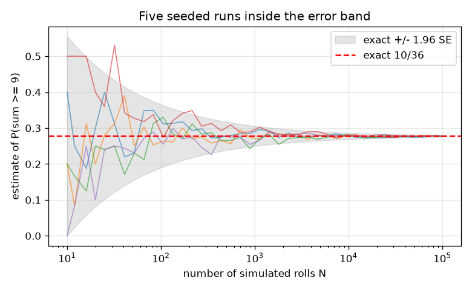
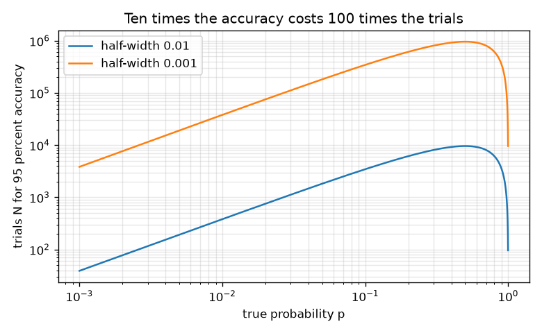

# Session 3: Monte Carlo simulation, its error, and when it fails

*Level 3 (simulation and validation) · about 90 minutes · openodds*

> This is a simplified educational model. It is not a validated design tool and must not be used for real structures, electrical installations, vehicles, industrial processes or medical decisions.

**Prerequisites**

- Session 1: relative frequency and the seeded generator.
- Session 2: counting, expected value and the lottery idea.

**Learning objectives.** After this session you can:

- Estimate a probability by seeded simulation and compare with the exact value.
- Use the standard error sqrt(p(1-p)/N) to say how accurate an estimate is and how many trials are needed.
- Explain the law of large numbers and why the gambler's fallacy is wrong.
- Show, with the 6-of-49 lottery, why simulation fails for rare events and exact counting or importance sampling is needed.

## A. Real-world problem
When the exact count is too hard, we can play the game many times on a computer and see how often the event happens. But how close is that answer, how many plays do we need, and why can nobody simulate their way to a lottery jackpot with odds of 1 in 13,983,816? This session also checks whether a game you design is fair. It is education about chance, not betting advice.

## B. Concept and theory
Monte Carlo estimate: run N independent trials and set p_hat = (trials where the event happened) / N. With a seeded generator the same seed repeats the same estimate. The estimate is random: for a true probability p its standard deviation (the standard error) is SE = sqrt(p(1-p)/N). About 95 percent of estimates lie within 1.96 SE of p. To get a 95 percent half-width e, we need N >= 1.96^2 p(1-p)/e^2; for p = 1/2 and e = 0.01 that is 9604 trials. Ten times better accuracy costs 100 times more trials. The law of large numbers says p_hat settles near p, but separate trials have no memory: after 5 heads in a row the next flip is still 50:50 (the gambler's fallacy is believing otherwise). A lottery with 6 numbers out of 49 has C(49,6) = 13,983,816 equally likely draws, so one ticket wins the jackpot with probability 1/13,983,816. If a ticket costs c and the jackpot is J (smaller prizes ignored) the expected loss is c - J/13,983,816. For rare events the relative error is sqrt((1-p)/(pN)), so N must be about 1/(p x relative error squared): plain simulation needs hundreds of millions of draws just to find the jackpot probability to 30 percent. Exact counting, or importance sampling that samples the rare event on purpose and re-weights, is needed.

| Symbol | Meaning | Unit |
|---|---|---|
| p | true probability of the event | no unit (0 to 1) |
| N | number of simulated trials | count |
| p_hat | simulated estimate of p | no unit (0 to 1) |
| SE | standard error of p_hat | no unit |
| e | wanted 95 percent half-width | no unit |
| c, J | ticket price, jackpot | Rs |

**Assumptions**

- Trials are independent and each has the same probability p.
- The pseudo-random generator behaves like true randomness for these purposes.
- The 95 percent rule uses the normal approximation, which is poor when N p is very small.
- Lottery: only the jackpot is counted; the smaller prizes would lower the expected loss a little. Prices are illustrative.

$$ \hat p=\dfrac{\text{trials with the event}}{N} $$

$$ \mathrm{SE}=\sqrt{\dfrac{p(1-p)}{N}} $$

$$ N\ge\dfrac{1.96^{2}\,p(1-p)}{e^{2}} $$

$$ \binom{49}{6}=13\,983\,816,\qquad E_{\text{loss}}=c-\dfrac{J}{13\,983\,816} $$

$$ \dfrac{\mathrm{SE}}{p}=\sqrt{\dfrac{1-p}{pN}}\;\Rightarrow\;N\approx\dfrac{1}{p\,r^{2}}\ \text{for relative error } r $$

## C. Visual explanation
The first figure shows five seeded simulation runs of the probability that two dice sum to at least 9 (exact 10/36 = 0.278). The grey band is the exact value plus or minus 1.96 standard errors: it is wide for small N and narrows like one over the square root of N, and the runs stay inside it. The second figure shows the number of trials needed against the true probability for two accuracy targets: ten times the accuracy sits 100 times higher, and rare events need far more trials.

*Five seeded runs settle inside the 95 percent error band around 10/36.*

*Trials needed against the true probability: ten times the accuracy costs 100 times the trials.*

## D. Interactive simulation
Run the lesson (`python start.py 3`), then open the live app: [Session 3: Monte Carlo and its error](https://krunalpanchal1995.github.io/openodds/session-03/) (or `app.html` in this folder). Set the true probability, the number of trials and the seed. In the band view see the estimate settle inside the 95 percent band; change the seed to see a different path. In the lottery view see how tiny a part of the 13,983,816 draws your simulation covers.

**Challenge.** Estimate a probability of 0.5 with a standard error below 0.005.

## E. Worked example and experiment
**Problem.** How many simulated trials are needed to estimate a probability near 0.5 to within plus or minus 0.01 (95 percent)? Then find the expected loss on a Rs 100 lottery ticket when the jackpot is Rs 10 crore (Rs 100,000,000), counting only the jackpot.

1. Worst case p = 0.5: p(1-p) = 0.25.
2. N >= 1.96^2 x 0.25 / 0.01^2 = 3.8416 x 0.25 / 0.0001 = 9604 trials.
3. Check: SE = sqrt(0.25 / 9604) = 0.0051, and 1.96 x 0.0051 = 0.0100.
4. Lottery: P(jackpot) = 1 / 13,983,816. Expected jackpot winnings = 100,000,000 / 13,983,816 = Rs 7.15.
5. Expected loss = 100 - 7.15 = Rs 92.85 per ticket, ignoring smaller prizes.

**Answer.** 9604 trials are enough for plus or minus 0.01 at p = 0.5; the Rs 100 ticket loses about Rs 92.85 per ticket on average (jackpot only).

**Experiment.** Flip a coin 100 times by hand, record the fraction of heads, and repeat 10 times: the ten fractions scatter by about 0.05 (SE = sqrt(0.25/100) = 0.05). Compare with the simulation. Real coins are slightly biased and people flip with habits, so the real scatter can differ from the model.

## Real-world application and mini-project: Design a fair game and check it by simulation
Invent a dice game with a price and a payout. You pay a price, roll two dice, and win the gross payout when the sum is in a set you choose. Use exact counting to set the payout so that the expected net gain is 0, then use `simulate_game` from Session 3 with a seed and a large N to check it. Also show that a payout 10 percent too small is caught by your simulation. This is education about chance, not a real gambling product.

**Deliverable:** A script that prints the winning set, its exact probability as a fraction, the fair payout, the simulated mean net gain with its standard error for the fair payout and for a payout that is 10 percent too small, and a one-line verdict for each.

**Success looks like:** The fair payout gives a mean net gain within 3 standard errors of 0, while the 10 percent too small payout gives a mean that is more than 3 standard errors below 0 (for the sum-at-least-9 game with price 10, payout 36 passes and payout 32.4 is caught at N = 200000).

## F. Assessment and design challenge
**Question type A: Conceptual.** A coin has landed heads 5 times in a row. A friend says tails is now due. Another says the coin must be biased. Who is right?

Hint

Compare the chance of 5 heads from a fair coin with the information the next flip carries.

Step-by-step solution

For a fair coin the next flip is still 50:50, because flips are independent: the simulation after 5 heads gives 0.50 heads. The first friend commits the gambler's fallacy. The second is not certain either: 5 heads in a row has probability 1/32 = 0.031 for a fair coin, which happens often enough in a long sequence that it is weak evidence of bias. More flips would help.

**Question type B: Numerical.** You want to estimate P(two dice sum to at least 9) = 10/36 with a 95 percent half-width of 0.005. How many trials? How many if you want 0.0005?

Hint

N = 1.96^2 p (1 - p) / e^2.

Step-by-step solution

p(1-p) = 0.2778 x 0.7222 = 0.2006. For e = 0.005: N = 3.8416 x 0.2006 / 0.000025, about 30,800 (30,828 with full precision). For e = 0.0005 (ten times smaller) N is 100 times larger: about 3,082,800. Sanity check: ten times the accuracy costs 100 times the trials.

**Question type C: Graph and simulation interpretation.** In the band figure, a run leaves the grey band at N = 200 but is inside it at N = 20000. Is the simulation broken?

Hint

What fraction of runs should leave a 95 percent band?

Step-by-step solution

No. A 95 percent band is left by about 5 percent of runs at any given N, so a run can step outside occasionally, especially at small N where the band is wide and the normal approximation is rough. What matters is that over many runs about 95 percent stay inside, and that the spread falls like 1/sqrt(N). The checkpoint tests this with 200 seeds.

**Question type D: Design and optimisation challenge.** Design a fair game: pay Rs 10, roll two dice, win a gross payout if the sum is at least 9. What payout makes it fair? Choose N to check it by simulation to within a standard error of 0.05 Rs and say what you would see for a payout of Rs 30.

Hint

p = 10/36; fair payout = price / p. The standard deviation of one play is about Rs 16.

Step-by-step solution

Fair payout = 10 / (10/36) = Rs 36. For payout 30 the expected net gain is 10/36 x 30 - 10 = -Rs 1.67. One play has a standard deviation of about Rs 16, so N = (16/0.05)^2, about 100,000 trials or more; with N = 200000 the checkpoint finds a standard error near Rs 0.04 and a mean near -1.63. A fair game shows a mean within 3 standard errors of 0. Trade-off: more trials cost time. Assumption: fair dice.

Score yourself with [RUBRIC.md](../../RUBRIC.md). Print the [activity sheet](activity_sheet.md) to work on paper.

## Common misconceptions
| Common misconception | What is actually true |
|---|---|
| After many tails, a head is due. | Trials have no memory. The fraction settles because early deviations are diluted, not corrected. |
| If the simulation never finds the event, its probability is 0. | It only says p is small compared with 1/N. Estimating the 6-of-49 jackpot from 200,000 draws finds nothing, but the probability is 1 in 13,983,816. |
| Doubling the trials halves the error. | The error falls like 1/sqrt(N): doubling the trials cuts it by about 29 percent; you need four times the trials to halve it. |

## Glossary
- **Monte Carlo**: estimating a quantity by repeated random simulation
- **standard error**: the typical size of the random error of an estimate; sqrt(p(1-p)/N) for a frequency
- **law of large numbers**: the fraction of successes settles near the true probability as N grows
- **gambler's fallacy**: the false belief that past independent results change the next one
- **importance sampling**: simulating the rare event on purpose and re-weighting the results
- **rare event**: an event with a probability so small that plain simulation rarely sees it

## Finish
1. Do the three coding tasks in [exercises.md](exercises.md).
2. Run `python start.py 3` again after your changes. It ends with the checkpoint; when it prints `PASS`, you are done. (Checkpoint only: `python start.py check 3`.)

Next: the [roadmap](../../promo/roadmap.md). Session 4 is yours to build.
